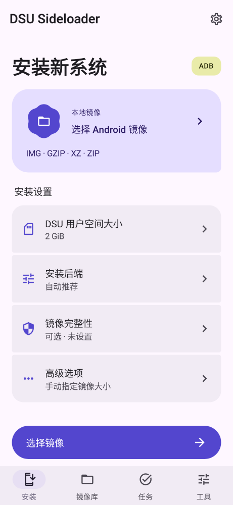
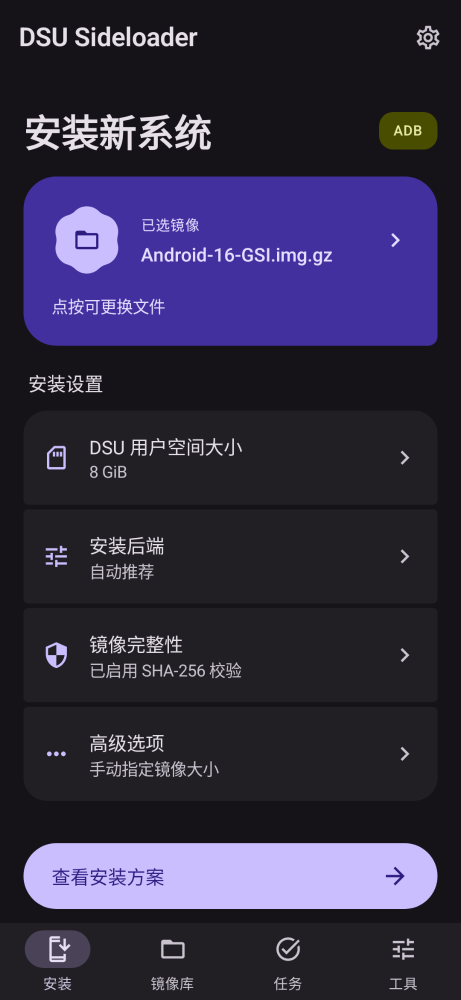
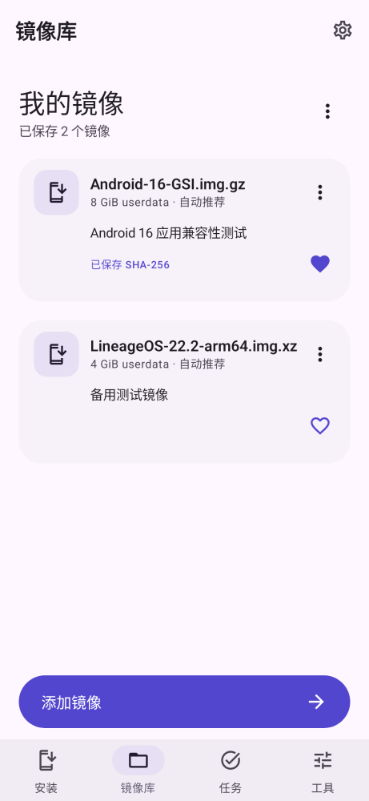

# Material 3 Expressive 界面重做

首版的超大宣传标题和圆角卡片堆叠已被用户否定。本版以官方 Material 3 Expressive 组件为基础，重新安排信息和操作。静态预览用于检查布局，不宣称已经完成用户或设备验收。

## 页面与层级

- 安装：中等大小的任务标题、来源选择容器、分组设置摘要、固定在底部的一个主操作。未选文件时选择镜像；已选后查看确认方案，不直接跳过确认提交。
- 设置摘要：userdata、后端、校验、高级选项。每项有标题、当前值、向前入口；详细输入放入 Material 3 底部面板，首页不常驻表单。
- 镜像库：紧凑文件条目、容量/后端摘要、收藏和更多菜单；添加为底部主操作，导入/导出为库级菜单。名称最多两行，备注最多两行。
- 任务：保留真实安装阶段、错误、取消和清理状态。没有后台持久化证据时，只描述当前会话。
- 工具：权限模式、日志、已准备的 ADB 命令和官方说明入口，不放宣传横幅。

## 对应组件

| 设计需求 | 实现 |
| --- | --- |
| Expressive 主题及弹簧运动体系 | `MaterialExpressiveTheme` / `MotionScheme.expressive()` |
| 主操作按压形变 | `Button(shapes = ButtonDefaults.shapes())` |
| 紧凑底部导航 / 宽屏导航 | `ShortNavigationBar` / `WideNavigationRail` |
| 容量、外观连接选择 | `ToggleButton` + `ButtonGroupDefaults.connected*ButtonShapes()` |
| 来源视觉锚点 | `MaterialShapes.Cookie6Sided.toShape()`，仅用于小面积图标容器 |
| 未知进度 / 确定进度 | `LoadingIndicator` / `LinearWavyProgressIndicator` |
| 参数和确认面板 | Material 3 `ModalBottomSheet`，替换旧 Material 2 实现 |

## 视觉规则

- 使用配对的 Material 色彩角色。primary 为主要操作；primaryContainer 为当前来源；tertiaryContainer 只标识权限上下文，不表示安装成功；错误保留 error 角色。
- 品牌基础为紫色，辅助为黄绿色；系统动态配色、浅色和深色仍可选择。预览使用固定品牌色，避免依赖壁纸。
- 正文采用 Material 14/20 与 16/24；标题用 22/28、24/32 和 32/40。没有占据半屏的宣传文案。字号跟随系统，不锁定 fontScale。
- 常用间距 4/8/12/16/20/24/32dp。分组中间连接圆角为 4dp，组边缘为 20dp，来源为非对称 28dp / 8dp。主按钮的形变由官方 API 提供，不用静态大胶囊替代所有组件。
- 来源、导航和操作有各自的形状与颜色层级，不让每项内容都成为同一种大圆角卡片。
- 840dp 起使用侧栏和双栏；底部主按钮最大 480dp。内容可滚动，固定操作与导航独立，宽屏也留系统底部安全区。
- 触控目标至少 48dp，主要操作至少 52/56dp；按钮文字可换行，面板可滚动。来源声明按钮角色；后端选项整行具有单选语义，图标不重复播报。

## 状态与验证边界

“已提交、未确认”和“清理结果无法确认”不改写为成功；未知进度不显示模拟百分比。按钮仍走既有 ViewModel、任务锁、确认及取消入口，终态回调继续检查任务身份。

截图由生产组件通过 layoutlib 渲染，固定数据和无副作用回调，包含空来源、已选来源和镜像库。静态图不能证明弹簧动效手感、文件选择、面板触摸/键盘、TalkBack、窗口系统栏、Android 10、Binder 或 DSU 安装已验收。没有 KVM，不启动模拟器。

官方依据：
- https://m3.material.io/blog/building-with-m3-expressive
- https://developer.android.com/develop/ui/compose/designsystems/material3
- https://developer.android.com/jetpack/androidx/releases/compose-material3

依赖选择和实验 API 风险见 [工具链说明](../decisions/EXPRESSIVE_TOOLCHAIN.md)。

## 实际组件预览

以下为 layoutlib 生产组件截图，非设备截图或生成式效果图。完整生成过程见 [预览工具](../../tools/ui-preview/README.md)，来源摘要见 [origin.json](previews/origin.json)。

  

[200% 字体安装页](previews/install-large-text.png) · [200% 字体镜像库](previews/library-large-text.png) · [真实横屏双栏](previews/install-wide.png)

人工查看：来源与设置层级、浅深主题、主操作、宽屏侧栏/双栏已检查；200% 字体时内容需要滚动，底部操作与导航保留可见。未测触摸、键盘、TalkBack 和真实动画。初次宽屏预览因设备方向为竖屏而无效，已修正为 LANDSCAPE 后重新渲染；无效图未用于本报告。
